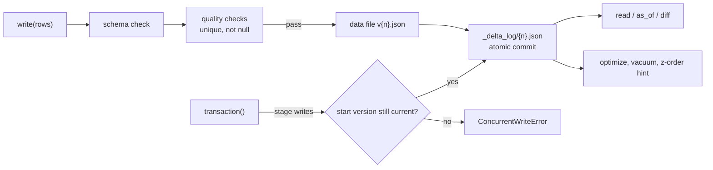

# Jagadish-data-lakehouse

[](https://github.com/jagadishmazure-jpg/Jagadish-data-lakehouse/actions/workflows/ci.yml)
[](https://github.com/jagadishmazure-jpg/Jagadish-data-lakehouse/actions/workflows/codeql.yml)


**A small lakehouse table format built from scratch to learn how it works: a JSON transaction log, ACID writes with optimistic concurrency, schema enforcement and evolution, quality checks on write, time travel, diffs, optimize and vacuum. Offline, stdlib only.**

> Personal learning and portfolio project. Everything runs offline on synthetic,
> fictional data with no API keys. Nothing is deployed. Numbers in this README
> come from real runs and are re-checked by CI (`scripts/render_docs.py --check`).

## Recruiter summary

- Implements the core ideas behind open table formats (a transaction log over data files) in about 700 lines of plain Python with tests.
- Real run: four writes and a two-write transaction, three bad writes rejected (duplicate id, null, wrong type), a concurrent writer detected, a schema evolved, time travel and a version diff, then vacuum makes old versions unreadable with a clear error.
- Written to explain lakehouse behaviour in interviews from first principles, not as a replacement for a real format.

## Purpose

Data and AI platform work keeps coming back to lakehouse tables: why a failed
job does not leave half a table, how two writers are stopped from clobbering
each other, what time travel costs, and why vacuum breaks it. I wanted to
answer those from code I had written, so this repo builds a toy version of
the mechanism and tests each property.

## Architecture



## How it works

**Table and log** (`lakehouse/table.py`): each commit writes data files, then
one log entry per version (`_delta_log/00000000000000000003.json`). A version
exists only once its log entry is written, so a crash before that leaves no
visible change. Reading a version that has no log entry raises
`VersionNotAvailable`.

**Schema** (`lakehouse/schema.py`): typed columns enforced on every write;
`evolve()` adds columns explicitly, old rows read back without them.

**Checks** (`lakehouse/checks.py`): registered on the table, run before the
commit, so a failing batch never becomes a version.

**Transactions** (`lakehouse/transactions.py`): writes are staged, validated
together, and committed only if the table is still at the version the
transaction started from (optimistic concurrency).

**Time travel and maintenance** (`lakehouse/time_travel.py`,
`lakehouse/maintenance.py`): `as_of` version or timestamp, `diff` between
versions, `optimize`, `vacuum` with a retention count, and a z-order hint.
Concepts: [docs/delta-concepts.md](docs/delta-concepts.md).

**Decontamination** (`lakehouse/decontaminate.py`): before a training table is
used, train rows that copy an eval row are removed. A row is "exact" if its
normalised text equals the eval row, and "near" if its word 5-shingle Jaccard
clears the threshold after a MinHash prefilter. Every removal is reported with
its score and the eval row it matched.

## Real code and output

```python
"""Versioned writes, quality gates, a concurrent-writer conflict, schema
evolution, time travel, optimize and vacuum on a throwaway table."""
import tempfile

from lakehouse.checks import CheckViolation, expect_no_nulls, expect_unique
from lakehouse.decontaminate import decontaminate
from lakehouse.maintenance import optimize, vacuum
from lakehouse.schema import Schema, SchemaViolation
from lakehouse.table import DeltaTable, VersionNotAvailable
from lakehouse.time_travel import as_of, diff
from lakehouse.transactions import ConcurrentWriteError

with tempfile.TemporaryDirectory() as tmp:
    schema = Schema({"id": "int", "item": "str", "amount": "float"})
    orders = DeltaTable(f"{tmp}/orders", schema=schema)
    orders.register_checks(expect_no_nulls("item"), expect_unique("id"))
    orders.write([{"id": 1, "item": "book", "amount": 9.5}])
    orders.write([{"id": 2, "item": "pen", "amount": 1.5}])
    print("v0 (time travel):", as_of(orders, 0))
    with orders.transaction() as txn:
        txn.write([{"id": 3, "item": "desk", "amount": 120.0}])
        txn.write([{"id": 4, "item": "lamp", "amount": 35.0}])
    print("after transaction:", len(orders.read()), "rows")

    for bad, label in [([{"id": 1, "item": "chair", "amount": 50.0}], "duplicate id"),
                       ([{"id": 9, "item": None, "amount": 5.0}], "null item"),
                       ([{"id": "x", "item": "mug", "amount": 4.0}], "wrong type")]:
        try:
            orders.write(bad)
        except (CheckViolation, SchemaViolation) as e:
            print(f"rejected ({label}):", e)

    txn = orders.transaction()
    txn.__enter__()
    orders.write([{"id": 5, "item": "cup", "amount": 3.0}])   # another writer commits first
    txn.write([{"id": 6, "item": "tray", "amount": 7.0}])
    try:
        txn.__exit__(None, None, None)
    except ConcurrentWriteError as e:
        print("conflict:", e)

    evolved = DeltaTable(f"{tmp}/orders", schema=schema.evolve({"region": "str"}))
    evolved.write([{"id": 7, "item": "rug", "amount": 60.0, "region": "west"}])
    print("diff v0 -> latest:", diff(evolved, 0, len(evolved.history()) - 1))
    print("history:", [(h["version"], h["operation"]) for h in evolved.history()])
    print("optimize:", optimize(evolved))
    print("vacuum (keep 2 versions):", vacuum(evolved, retain_versions=2))
    try:
        as_of(evolved, 0)
    except VersionNotAvailable as e:
        print("time travel past retention:", e)

# Eval-set decontamination: strip train rows that copy or paraphrase eval rows before training.
eval_rows = [{"id": "e1", "text": "Which warehouse had the most late shipments in the second quarter of last year?"},
             {"id": "e2", "text": "List every supplier whose on-time rate fell below ninety percent this month."}]
train_rows = [
    {"id": "t1", "text": "which warehouse had the most late shipments in the second quarter of last year?"},
    {"id": "t2", "text": "Which warehouse had the most late shipments in the second quarter of last year overall?"},
    {"id": "t3", "text": "How many pallets were received at the north depot on Monday morning?"},
]
clean, report = decontaminate(train_rows, eval_rows, threshold=0.7)
print(f"Decontamination: kept {report.kept}/{report.train_total} train rows; removed "
      + ", ".join(f"{r.train_id} ({r.kind}, Jaccard {r.score:.2f} vs {r.eval_id})" for r in report.removed))
```

Output of `python examples/demo.py` (real run, re-checked in CI):

<!-- run: python examples/demo.py -->
```text
v0 (time travel): [{'id': 1, 'item': 'book', 'amount': 9.5}]
after transaction: 4 rows
rejected (duplicate id): [CHK-UNIQ-id] duplicate value 1 in 'id' (rows 0 and 4)
rejected (null item): column 'item': expected str, got NoneType (None)
rejected (wrong type): column 'id': expected int, got str ('x')
conflict: concurrent write detected: table moved from version 2 to 3 during transaction
diff v0 -> latest: {'added': [{'amount': 1.5, 'id': 2, 'item': 'pen'}, {'amount': 3.0, 'id': 5, 'item': 'cup'}, {'amount': 35.0, 'id': 4, 'item': 'lamp'}, {'amount': 60.0, 'id': 7, 'item': 'rug', 'region': 'west'}, {'amount': 120.0, 'id': 3, 'item': 'desk'}], 'removed': [], 'added_count': 5, 'removed_count': 0, 'from_version': 0, 'to_version': 4}
history: [(0, 'WRITE'), (1, 'WRITE'), (2, 'TRANSACTION'), (3, 'WRITE'), (4, 'WRITE')]
optimize: {'operation': 'OPTIMIZE', 'files_before': 5, 'files_after': 5}
vacuum (keep 2 versions): {'operation': 'VACUUM', 'removed_versions': [0, 1, 2]}
time travel past retention: version 0 is not available: it was never written or was removed by VACUUM (current version 4)
Decontamination: kept 1/3 train rows; removed t1 (exact, Jaccard 1.00 vs e1), t2 (near, Jaccard 0.75 vs e1)
```
<!-- /run -->

## How to run

```bash
git clone https://github.com/jagadishmazure-jpg/Jagadish-data-lakehouse.git
cd Jagadish-data-lakehouse
python -m pip install pytest      # no runtime dependencies
python -m pytest -q          # offline, no keys
python examples/demo.py
python scripts/render_docs.py --check   # documented output still matches
```

Test suite size (real collection, re-checked in CI):

<!-- run: python scripts/count_tests.py -->
```text
64 tests collected
```
<!-- /run -->

## Guardrails

- Schema and quality checks run before commit; a rejected batch leaves no version behind.
- Concurrent writers are detected and the later commit is refused, not merged silently.
- Vacuum refuses a retention below 1, and reading a vacuumed version raises a named error.

## Limitations

- Each version stores a full snapshot, not only the changed rows, so `optimize` has nothing to compact in the demo (5 files before and after).
- `optimize` rewrites log entries in place; real formats keep the log append-only.
- Commit atomicity relies on a single local filesystem; there is no object-store put-if-absent.
- Z-ordering is a recorded hint only; no data is reordered.
- JSON files, not Parquet; no partitioning, statistics or data skipping.
- Decontamination compares every train row with every eval row (no LSH banding), so it suits thousands of rows, not millions.
- Punctuation stays attached to words, so 'year?' and 'year' differ; the demo's paraphrase scores 0.75 and needs a 0.7 threshold.

## Built vs planned

| Capability | Status | Where |
|---|---|---|
| Versioned table with a JSON log | Built | `lakehouse/table.py` |
| Schema enforcement and evolution | Built | `lakehouse/schema.py` |
| Quality checks on write | Built | `lakehouse/checks.py` |
| Transactions with optimistic concurrency | Built | `lakehouse/transactions.py` |
| Time travel, diff, optimize, vacuum | Built | `lakehouse/time_travel.py`, `lakehouse/maintenance.py` |
| Eval-set decontamination (exact + MinHash near-duplicate) | Built | `lakehouse/decontaminate.py` |
| Change-only files, Parquet, partitioning | Planned | not started |
| Object-store commit protocol | Planned | docs/implementation-guide.md |

## Threat model

| Threat | Mitigation in this repo | Status |
|---|---|---|
| Bad data committed by a pipeline | Schema and quality checks before commit | Built |
| Two writers overwrite each other | Optimistic concurrency check at commit | Built |
| Restore needed after vacuum | Retention count; clear error when a version is gone | Built |
| Partial commit on crash in object storage | Atomic log commit protocol | Planned |

## Interview points

- A version exists only when its log entry exists; that is where atomicity comes from.
- Optimistic concurrency: check the version at commit, refuse if it moved.
- Vacuum trades storage for the time travel window; the demo shows the failure after it.

More, with likely follow-up questions: [docs/interview-points.md](docs/interview-points.md).

## Implementation guide

The step-by-step path from this offline build to an Azure deployment is in
[docs/implementation-guide.md](docs/implementation-guide.md). None of it has been
run; it is a plan.

## Related repositories

| Repo | How it relates |
|---|---|
| [Jagadish-data-governance](https://github.com/jagadishmazure-jpg/Jagadish-data-governance) | Catalog, grants and masking over tables like these |
| [Jagadish-fabric-enterprise-bi](https://github.com/jagadishmazure-jpg/Jagadish-fabric-enterprise-bi) | A real lakehouse-based BI build on Azure |
| [Jagadish-ai-data-readiness](https://github.com/jagadishmazure-jpg/Jagadish-ai-data-readiness) | Checking data quality before AI use |
| [Jagadish-governed-data-agent](https://github.com/jagadishmazure-jpg/Jagadish-governed-data-agent) | An agent reading governed data |

## Documentation

- [Lakehouse concepts](docs/delta-concepts.md)
- [Implementation guide (Azure)](docs/implementation-guide.md)
- [Interview points](docs/interview-points.md)
- [Security policy](SECURITY.md)

## Project layout

```
lakehouse/
  table.py         versions, log, read, VersionNotAvailable
  schema.py        typed columns, evolve, merge
  checks.py        quality gates on write
  transactions.py  staged writes, optimistic concurrency
  time_travel.py   as_of, as_of_timestamp, diff
  maintenance.py   optimize, vacuum, z-order hint
  decontaminate.py exact + near-duplicate eval leakage removal
examples/demo.py   the run shown above
tests/             offline pytest suite
```

## License

MIT, see [LICENSE](LICENSE). All data is synthetic; every organisation and person is fictional.
